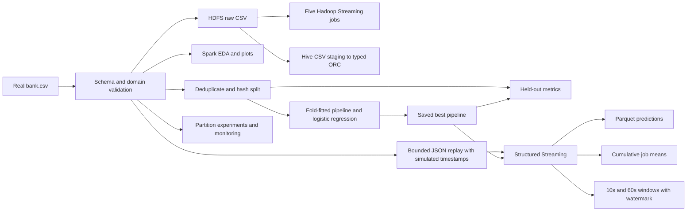

# Design and limitations

## Data flow

## Data contract

Seven numeric fields, nine categorical fields and y follow the original UCI bank format. balance is account balance, not loan principal. default is existing credit default, not a future loan-default label. duration is last-contact seconds, not payment duration. y is subscription, not fraud.

Day/month alone do not establish a year or timestamp. Replay timestamps are simulated. No durable real client ID exists; row counts represent records. Exact duplicate removal is a conservative modeling choice, not verified client deduplication. Different records for one real client could still cross the split; true client/time validation requires richer identifiers and dates.

## Aggregation

Hadoop emits sum/count and merges them associatively in the combiner. Reducers use bounded memory per sorted key. Two reducers demonstrate key partitioning. Missing numeric values contribute neither sum nor denominator.

Hive CSV SerDe staging stays string-typed; casts load typed ORC. Raw CSV remains externally managed. The education anomaly screen compares group means descriptively using a two-standard-deviation review threshold; small category counts and heavy tails limit its interpretation.

Spark EDA uses native transformations except the explicitly required age Python UDF. Median is approximate. Pandas conversion is bounded to small aggregates/previews. Invalid labels, domains and malformed numeric tokens fail validation.

## Model

Labels map yes=1/no=0 independently of class frequency. A seeded row hash gives approximately 80/20 train/test after exact-row deduplication. CV uses a different hash; every fold and both split sets must contain both labels. This is reproducible non-temporal validation.

Fixed signed log(balance) and log1p counts reduce outlier influence. pdays=-1 maps to contacted_before=0 and transformed pdays=0. Missing numeric values use fold-fitted medians; missing categories become unknown and unseen categories are retained. All preprocessing estimators are inside the CV pipeline. No test quantiles are learned.

Duration is excluded by default; the optional all-predictor model must be labeled retrospective/post-contact. Other fields, such as current campaign count and contact scheduling, also need review against the exact intended scoring time.

Four regularization combinations and three folds keep compute bounded. Mean validation PR-AUC selects the model, which refits on all training rows. Test metrics include positive precision/recall/F1, ROC-AUC, PR-AUC, accuracy and majority baseline at an untuned threshold of 0.5. Coefficients are conditional associations on transformed features, not causal importance.

## Streaming

Four independent queries read files with maxFilesPerTrigger=1: predictions, cumulative job means, and two window sizes. All valid records are scored; labels may be missing and are never features. Invalid timestamp/ID/domain records are excluded; the replay validates before publication. A production source should quarantine rejected events and monitor counts.

Cumulative job means use complete mode; state is small for this dataset's job categories. Tumbling windows use update mode and a 20-second event-time watermark. Within-threshold lateness is supported; beyond-threshold events may be dropped. Watermarks advance from observed event time and batch progress, not wall time. A late event can still appear in predictions and job means while being excluded from a window.

Unique replay IDs avoid duplicate events within one run. Separate query checkpoints and the Parquet file sink provide recovery primitives, but the CLI deliberately requires fresh output directories for reviewable runs. No exactly-once guarantee is claimed across separate replays or changed checkpoints. Resuming would require an unchanged query and an entrypoint loading its original checkpoints.

Late-drop counts depend on prior watermark progress and microbatch order; synthetic lateness labels alone do not prove drops. Inspect eventTime.watermark and stateOperators.numRowsDroppedByWatermark in query_progress.jsonl. Last windows may stay open without future event-time progress.

## Parallelism and monitoring

Round-robin repartitioning avoids initially concentrating popular job keys. Aggregation still shuffles by job and adaptive execution can coalesce partitions. Benchmarks include repartition cost, warm input once, repeat each setting, and check aggregate consistency. No dataset replication is used.

Two InheritableThread actions use FAIR pools and per-thread job groups. Concurrent work can compete instead of speeding up. CV parallelism is independently bounded.

psutil records driver Python CPU/RSS, host CPU/memory and local child JVM RSS. These are not remote executor measurements; Spark UI and event logs provide executor task/GC/spill/shuffle metrics. local[2] is parallel execution on one machine. Multi-node claims require real cluster application IDs, executor lists and stage evidence.

## Requests limited by the dataset

- Year-over-year contacts require real contact_year/contact_date. Do not infer year from row order.
- Ranking loan amounts by age requires observed loan_amount/principal linked to real clients. The provided loan-holder-count ranking is a separate proxy.
- Education balance summaries are cross-sectional. The average-yearly-balance attribute is not an annual panel.

State these limits explicitly and discuss them with the instructor if numeric answers are mandatory.
