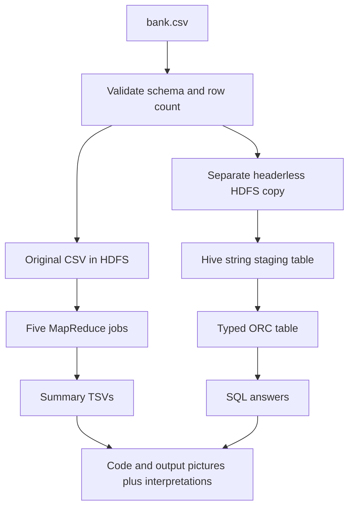

# Understand the Hadoop/Hive workflow

One bank-marketing CSV supplies customer-analysis questions. We answer them using Python MapReduce and Hive SQL. The four other assignments are completed separately in notebooks.

| Tool | What it does | Where you see it |
|---|---|---|
| Codespaces | Remote computer running this project | Browser editor and terminal |
| HDFS | Stores CSV and job outputs | NameNode UI, port 9870 |
| YARN | Allocates resources to Hadoop/Hive jobs | Applications UI, port 8088 |
| Hadoop Streaming | Runs the Python mapper/reducer | Five summary TSVs |
| HiveServer2 | Receives SQL and submits jobs | HIVE_READY confirms a test query |
| Beeline | SQL client talking to HiveServer2 | Tables printed in terminal/logs |
| Derby catalog | Remembers Hive tables and their locations | Persistent metastore directory |

## What each stage actually does

prepare validates the CSV, records its SHA256/counts and runs tiny offline tests. hadoop uploads the original CSV and runs five sequential jobs. Mappers emit a grouping key, sum and nonmissing count. Combiners merge partial sums/counts; reducers calculate means. For count questions, use the count column rather than the constant mean.

hive streams a headerless derivative directly to a separate HDFS directory, registers CSV fields as strings, casts into typed ORC, checks raw/typed counts and runs SQL. INSERT OVERWRITE refreshes the derived analysis table. The original CSV and Hadoop results remain intact.

verify only reads saved outputs and checks agreement. package creates a small ZIP. They do not repeat analysis jobs. The source calculations are in mapreduce/, src/banklib.py and hive/; run.sh automates the plumbing around them.

## Background processes and finite jobs

NameNode/DataNode provide HDFS. ResourceManager/NodeManager provide YARN. HiveServer2 receives SQL. These services stay running between commands; that does not mean a calculation is running. A YARN job is a finite calculation. STAGE_COMPLETE means its stage finished the runner's checks.

Capture YARN browser evidence before stopping Hadoop: the current setup does not recover its application list after restart. TSVs, service logs and HDFS data are stored separately and can remain. An empty UI is not proof of lost results.

## Evidence and limitations

Follow [EXECUTION.md](EXECUTION.md) for exact code/output pictures and [report_hadoop_hive.md](report_hadoop_hive.md) for all 22 prompts. Show your actual dataset counts and application IDs. Grouped age/balance means are not a correlation coefficient; education/balance anomaly screening is descriptive, not evidence of fraud. There is no year field for year-over-year analysis.

| Path | Purpose |
|---|---|
| scripts/codespaces/run.sh | prepare, hadoop, hive, verify, package |
| scripts/codespaces/services.sh | Start/stop this project's services |
| scripts/codespaces/env.sh | Persistent paths, resume helper and Hive settings |
| scripts/run_hadoop.sh | Five Hadoop Streaming jobs |
| src/banklib.py | CSV parsing and aggregation rules |
| hive/01_tables.hql | Table definitions and ingestion |
| hive/02_analysis.hql | SQL answers |
| artifacts/codespaces/current-run | Pointer to the selected results |
| .codespaces-state | Installed tools, HDFS blocks, catalog and service logs |

Stopping preserves the Codespace workspace; deleting the Codespace removes its local data. Download necessary evidence before deletion. Do not reinstall or reformat HDFS when resuming.