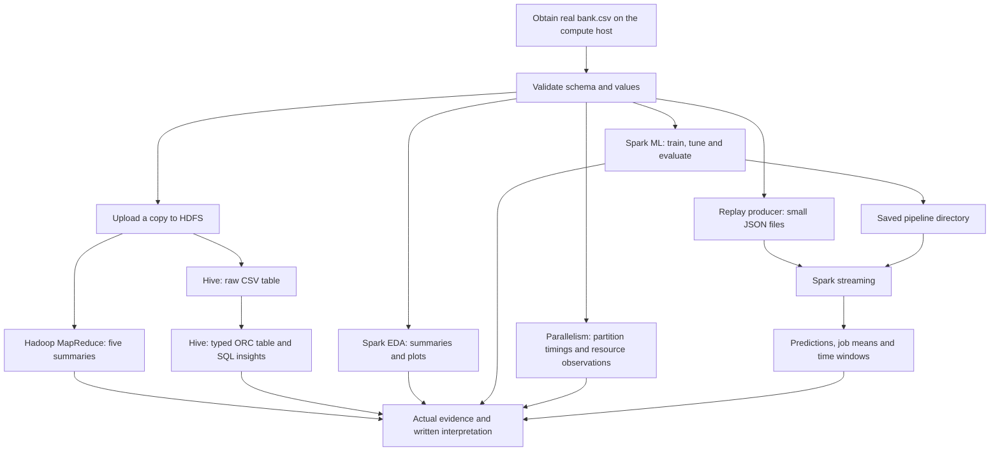

# Project overview: understand the workflow before running it

The current execution host is **GitHub Codespaces**, using the supplied setup/service scripts; an existing lab is no longer required. Read this first, then follow [EXECUTION.md](EXECUTION.md) for commands. This file explains what each stage accomplishes, how the tools connect, how to recognize a successful run, and what to do when a stage fails.

The implementation is ready for verification on a prepared compute environment. Real-data results, distributed runs and screenshots are still pending. The examples below explain behavior; illustrative numbers are not measured project findings.

## 1. What are we trying to achieve?

Imagine a bank planning a marketing campaign. It has a table of customer/contact records: age, job, account balance, loan status, previous campaign outcome, and whether the customer subscribed to a term deposit.

We answer three types of questions:

- **Understand the past:** Which jobs have higher balances? Which contact methods have higher subscription rates? How do previous campaign outcomes relate to current subscriptions?
- **Predict an outcome:** Can historical records help estimate whether a customer will subscribe?
- **Process arriving records:** Can we keep updating summaries and produce model predictions as new records arrive?

A fourth objective is about engineering: demonstrate how work is divided into partitions, scheduled, and measured with Hadoop and Spark.

The assignment uses several technologies to teach different approaches to the same dataset. A small bank.csv does not require a cluster for ordinary analysis. Here we use it to demonstrate patterns that also apply to larger data.

The model predicts **term-deposit subscription**, using y=yes or y=no as the known historical answer. This project does not implement stock-price forecasting, future credit-default prediction, or payment-fraud detection.

## 2. The tools and their jobs

| Tool or concept | Plain-language role | What it does in this project |
|---|---|---|
| CSV | The original spreadsheet-like file | Supplies the bank records and historical subscription labels |
| Python | The programming language | Validates records, implements mapper/reducer logic, coordinates Spark and produces replay files |
| Hadoop | The distributed-computing ecosystem | Provides the storage and batch-processing environment for the Hadoop assignment |
| HDFS | A filesystem managed by a Hadoop cluster | Holds the uploaded raw CSV and MapReduce outputs |
| YARN | The cluster resource manager in the documented Hadoop setup | Allocates resources and runs Hadoop tasks |
| MapReduce | A batch calculation pattern | Divides input, groups matching keys, and calculates the five requested summaries |
| Hive | A SQL table/query layer over stored data | Gives banking records table names/types and answers the Hive analysis questions |
| Hive metastore | Hive's table catalog | Remembers schema, format and storage location; it is not itself the CSV data |
| HiveServer2 and Beeline | SQL service and its command-line client | Beeline sends the .hql scripts to the lab's Hive service |
| ORC | A column-oriented storage format | Stores the typed Hive table after CSV ingestion |
| Spark / PySpark | A processing engine and its Python interface | Runs EDA, model training, partition experiments and streaming queries |
| Spark ML | Spark's machine-learning library | Fits preprocessing plus logistic regression and saves a reusable model |
| Structured Streaming | Spark's incremental processing interface | Processes newly discovered JSON files in successive batches |
| Pandas and Matplotlib | Small-table handling and plotting | Convert bounded summaries/previews and create the two EDA charts |
| psutil and Spark UI | Resource observation | Record local process measurements and inspect Spark jobs/executors |
| Jupyter / Colab | An interactive place to run Python cells | Presents the three eligible Spark assignments with saved outputs |

**Spark does not require Hive or Hadoop to be running for the single-host examples.** Hive does not train the model, and MapReduce does not supply the model's training output. These are mostly separate assignment branches sharing the same source records.

## 3. How everything connects



There are two important connections to check during execution:

1. **Hadoop to Hive:** Hive's RAW_PATH must be the same HDFS directory into which the Hadoop launcher uploaded bank.csv.
2. **Training to streaming:** Streaming's --model must point to the fitted pipeline directory produced by the training run.

EDA and parallelism can run without completing Hive. Streaming needs a trained model and replay input, but not Hive query results.

## 4. Keep the execution locations clear

You are working with three different kinds of location:

| Location | What belongs there | Example |
|---|---|---|
| This Windows workstation | Source editing, document reading, lightweight checks | The repository currently open in PyCharm |
| A prepared development/compute host | Spark runtime, Python dependencies, data, models, reports and streaming files | The GitHub Codespace created from this repository |
| HDFS | Cluster-managed raw input and Hadoop outputs | /user/yourname/banking/raw/assignment-01 |

A relative path such as data/bank.csv refers to the filesystem of **the machine running that command**. Uploading code to a VM does not also upload the data unless you explicitly copy it.

Likewise, /user/yourname/banking/raw/assignment-01 is an HDFS path when passed to hdfs dfs or used by the configured Hive service. It is not a folder to look for in Windows Explorer.

The repository instructions use Linux/bash for Hadoop and remote Spark commands. Commands using export, $PWD and backslash line continuations belong in that remote Linux terminal. The workstation check commands use PowerShell syntax.

Because this workstation has limited storage, keep runtime installations, raw data, Spark temporary files, models, checkpoints and event logs on the compute host. Reading this guide or editing an .hql file does not start a service.

The course documents explicitly request local execution/screenshots for Hadoop/Hive and streaming. If using Codespaces, confirm the instructor accepts a remote development environment where the instructions require local execution. Colab is explicitly permitted for EDA, modeling and parallelism.

## 5. Start with the data contract

The expected input has 17 columns in the documented order. The original UCI CSV uses semicolons and quotes. Several fields look related but mean different things:

| Field | Meaning | Common misunderstanding to avoid |
|---|---|---|
| balance | Account balance | It is not the principal amount of a loan |
| loan | Whether a personal loan exists | yes/no does not tell us the loan amount |
| default | Existing credit-default status | It is not the subscription target |
| duration | Last contact's duration in seconds | It is not a payment transaction duration |
| day and month | Contact day/month attributes | They do not provide a year or a full timestamp |
| pdays=-1 | No previous contact | It does not mean a negative elapsed time |
| unknown | An explicit category for some fields | It should not automatically be interpreted as no |
| y | Historical subscription outcome | This is the answer the model learns to predict |

Use [validate_data.py](../scripts/validate_data.py) before expensive processing. It checks the schema, integer fields, allowed target/domain values and missing numeric counts while reading the file incrementally.

**Success checkpoint:** you know the real input file location, row count, label counts and file checksum, and validation completes without an exception. Do not start model training to discover that the wrong CSV variant was uploaded.

## 6. Hadoop: how mapper, combiner and reducer work

The [Hadoop launcher](../scripts/run_hadoop.sh) uploads bank.csv to a run-specific HDFS directory and submits five jobs:

| Job name | Grouping key | Requested result |
|---|---|---|
| balance_by_job | Job type | Average account balance |
| housing_by_education | Education and housing status | Count for each combination |
| contacts_by_month | Month and y | Contact-record count by month/subscription |
| duration_by_poutcome | Previous campaign outcome | Average contact duration |
| balance_by_age | Age group | Summary of balance by age group |

Consider an illustrative balance calculation:

```text
Input records:         job=technician, balance=100
                       job=technician, balance=300

Mapper emits:          technician    100    1
                       technician    300    1

Combiner can merge:    technician    400    2

Reducer emits:         technician    400    2    200.00000000
                       key           sum    count mean
```

The **mapper** turns each record into a key and a contribution. Hadoop's **shuffle** sends matching keys to the same reducer. An optional **combiner** adds local sums/counts to reduce data transfer. The **reducer** merges all contributions for a key and computes the final mean.

Why not average partial averages? One worker may process 100 records and another only two. Their means must be weighted by their counts. Sums/counts retain that information.

The launcher uses two reducers. Expect multiple part-* files; one file alone may not contain every key. For count jobs, use the count column. For average jobs, use the mean column.

**Success checkpoint:** each job completes, all reducer parts are inspected, and unexpected rejected-row counters are zero. Record the HDFS raw directory printed by the launcher for the next stage.

A shell pipeline with mapper.py, sort and reducer.py is only a logic simulation. A real Hadoop run additionally produces cluster job/task/counter evidence.

## 7. Hive: what 01_tables.hql actually does

The file you selected, [01_tables.hql](../hive/01_tables.hql), prepares data for SQL analysis. It is a script sent through Beeline; it does not start HiveServer2 or create a Hadoop cluster.

Follow it in this order:

| Script section | What it does | Why it exists |
|---|---|---|
| CREATE DATABASE / USE | Creates/selects banking_data | Organizes the assignment's tables |
| CREATE EXTERNAL TABLE client_info_raw | Registers the uploaded CSV as a table of strings | Gives Hive a way to read the existing raw files |
| OpenCSVSerde properties | Tell the CSV reader about semicolons and quoted fields | Avoids splitting/reading the UCI CSV incorrectly |
| LOCATION with RAW_PATH | Points the raw table at the uploaded HDFS directory | Connects Hive table metadata to real data |
| skip.header.line.count | Skips the header | Prevents column names from becoming a data record |
| ALTER TABLE ... SET LOCATION | Updates the staging location for a new run | CREATE IF NOT EXISTS alone would retain the old location |
| CREATE TABLE client_info | Defines numeric/string column types and ORC storage | Prepares a typed table for analysis |
| INSERT OVERWRITE ... SELECT | Reads CSV staging, trims/lowercases strings and casts numbers into ORC | Materializes the analysis-ready table |
| Final SELECT | Reports loaded/non-null counts | Helps detect ingestion problems before analysis |

RAW_PATH is supplied by --hivevar in the execution command. The expression ${hivevar:RAW_PATH} is a variable placeholder, not a directory that should exist literally.

There are **two tables**, not two different datasets:

- client_info_raw is a reading view over the external CSV files, using table metadata and a CSV reader.
- client_info is a derived, typed copy stored as ORC.

The raw staging table uses strings because quoted CSV parsing and numeric types need careful handling. The SELECT explicitly converts fields such as age to INT and balance to BIGINT.

INSERT OVERWRITE replaces the contents of the project's derived client_info table. It does not append another copy of the rows and does not delete the uploaded raw CSV. Make sure this database/table belongs to your assignment before refreshing it in a shared lab.

After this script succeeds, [02_analysis.hql](../hive/02_analysis.hql) asks the actual business questions: totals, filtering, top balances, subscription rates, correlation, and descriptive anomalies.

**Success checkpoint:** Beeline connects, the expected table schema appears, and loaded row counts agree with the validated input. A non-null age/balance count may be smaller only when those numeric fields are actually missing. Unexpected nulls suggest parsing or cast problems.

Hive and the Python MapReduce jobs can independently compute related summaries. Agreement is useful evidence that CSV parsing and grouping are correct. Spark EDA gives another comparison for job-average balances.

## 8. Spark EDA: understand the records before modeling

Spark reads the same validated CSV into a **DataFrame**, a table whose operations can be distributed across workers.

[spark_job.py](../src/spark_job.py) is the common launcher. Its eda option calls [eda.py](../src/eda.py), which:

1. Prints sample rows and schema, then reports numeric summaries and missing values.
2. Filters balances and derives month numbers, quarters and age groups.
3. Calculates group summaries, subscription/default proportions and correlation.
4. Uses a temporary SQL view for one of the requested analyses.
5. Converts only bounded previews/small aggregate tables to Pandas.
6. Writes small CSV/JSON outputs and the job/default-count plots.

A **transformation** describes a new DataFrame. An **action**, such as show, count, collect or writing results, makes Spark execute the required computation. A delay after defining a DataFrame does not necessarily mean anything has run yet.

**Success checkpoint:** the EDA output directory contains the numbered summaries and both PNG plots. Open them and write observations based on the actual counts and sample sizes.

## 9. Modeling: turn historical answers into a reusable prediction pipeline

A **feature** is an input available to the model; the **label** is the known historical answer y. The model must never use y as an input feature.

[modeling.py](../src/modeling.py) performs the following sequence:

```text
Historical records
    -> Remove exact duplicate rows
    -> Deterministic approximate 80% training / 20% test split
    -> Cross-validation within the training set
         -> Fixed transformations that reduce outlier influence
         -> Fit numeric missing-value replacement
         -> Fit category indexing and one-hot encoding
         -> Assemble one numerical feature vector
         -> Fit logistic regression
    -> Choose the best regularization settings using validation PR-AUC
    -> Refit the selected pipeline on all training records
    -> Evaluate once on held-out test records
    -> Save metrics, named coefficients and the fitted pipeline
```

**Imputation** replaces missing numeric values with training medians. **One-hot encoding** represents categories as indicator features instead of treating job names as quantities. **Logistic regression** learns a score/probability for a binary outcome. Here its usual decision threshold is 0.5.

**Cross-validation** temporarily divides training data into folds: fit on some folds, score on the held-out fold, and repeat. The default grid has four parameter combinations and three folds, followed by final refitting. This is why training takes more time than a single model fit.

Preprocessing is fitted inside each CV training fold. Otherwise information from the validation fold could influence the model being evaluated.

The default pipeline excludes duration because a last call's final duration is not available before that call. The --include-duration option is for a clearly labeled retrospective experiment.

Read the resulting metrics together:

| Output | What it helps you judge |
|---|---|
| Majority/always-no baseline | Whether accuracy is meaningful for an imbalanced target |
| Precision | Among predicted subscribers, how many actually subscribed |
| Recall | Among actual subscribers, how many the model identified |
| Positive F1 | Balance between positive-class precision and recall |
| ROC-AUC and PR-AUC | Ranking performance across thresholds; PR-AUC is especially useful with rare positives |
| Confusion counts | Actual numbers of correct/incorrect positive and negative predictions |
| Named coefficients | Conditional associations between encoded/transformed features and the prediction |

**Success checkpoint:** train/test/CV folds contain both labels, metrics and coefficients exist, and output/pipeline/ has been saved.

The pipeline is a **directory containing multiple fitted stages**, not just a metrics JSON file. Streaming needs this whole directory, including the learned imputer, encoders and classifier.

## 10. Streaming: apply that model while records arrive

The replay producer and streaming consumer are separate processes:

```text
Producer: bank.csv -> small JSON files published over time
Consumer: new JSON files -> saved pipeline -> predictions and updated summaries
```

[replay.py](../scripts/replay.py) is the **producer**. It reads a bounded number of bank records, adds unique event IDs and simulated event times, and publishes chunks using atomic rename. This prevents Spark from reading half-written files.

[streaming.py](../src/streaming.py) is the **consumer**. It loads the saved pipeline and starts four queries:

| Query | Result | Destination |
|---|---|---|
| predictions | One scored record for every valid input event | Parquet files in the output directory |
| job_means | Cumulative count, mean balance and mean contact duration per job | Console |
| window_10s | Counts and average balances in 10-second event-time windows | Console |
| window_60s | Counts and average balances in 1-minute event-time windows | Console |

Structured Streaming processes these files in small batches. In a finite run, --available-now consumes the available files then stops. In a live demo, start the consumer on an empty directory, then start the producer in another terminal.

Two clocks matter:

- **Event time:** when the simulated record says it happened.
- **Arrival/processing time:** when the file becomes available and Spark processes it.

A **window** groups records by event time. A **watermark** tells windowed processing how far event time has progressed and bounds how much old window state is retained. It is not a sleep timer.

For example, if observed event time has reached 12:01:00, a 20-second watermark delay can place the watermark around 12:00:40 once the query advances it. An event timestamped 12:00:50 is within that threshold; an older event may be dropped by the window query. Actual behavior depends on batch progress.

The replay deliberately includes out-of-order and very late timestamps. Check query_progress.jsonl for the observed watermark and dropped-row metrics rather than inferring drops only from the producer's delays.

A late record can still appear in predictions and cumulative job means while being excluded from a window. These queries have different state/late-data behavior.

A **checkpoint** stores a query's processing progress and state. Each query gets its own directory. Keep checkpoints on durable storage and use fresh run paths for the supplied demonstration commands. Do not change a query and reuse an old checkpoint, or casually delete checkpoints to silence an error.

**Success checkpoint:** the producer's bounded event count is known, predictions can be read and counted, both window queries update, and watermark observations are saved. Some last windows may stay open if no later event-time data arrives.

## 11. Parallelism: measure how work is divided

A **partition** is a piece of a distributed dataset. Spark tasks operate on partitions. Adding partitions creates opportunities for concurrent work but also adds scheduling and data-transfer overhead.

[parallelism.py](../src/parallelism.py) compares 1, 2 and 4 partitions by default. It distributes rows, repeats a job-average-balance aggregation, checks that results remain equivalent, and records times and partition sizes. It also trains a partitioned model and schedules two independent preprocessing actions.

**FAIR scheduling** allows concurrent jobs to share resources; it does not create additional CPU cores. **Caching** can reuse previously computed data but consumes memory and may spill to disk. **Shuffle** is data exchange needed to regroup records, for example by job.

local[2] means Spark runs on one host with two worker threads. Four partitions do not mean four machines or four simultaneously available cores.

The monitoring JSON describes the driver Python process, local child processes and host. Spark UI/event logs are needed for executor/task observations. Measure both instead of treating driver CPU as total cluster use.

**Success checkpoint:** actual partition sizes and repeated timing medians are present, aggregates agree, resource observations are captured, and the report states the real execution environment. Slower runs with more partitions are valid findings on a small CSV.

## 12. Use this order and pause at the checkpoints

| Stage | Requires | Confirm before continuing |
|---|---|---|
| Prepare environment | A compute host with the needed tools and disk | Correct terminal, working directory, interpreter and Java/Spark versions |
| Validate data | Real bank.csv on that host | Correct schema and known row/label counts |
| Hadoop jobs | Working Hadoop client, HDFS/YARN and task-node Python | Jobs complete; input and output paths are known |
| Hive ingestion/analysis | Hive service and the uploaded HDFS raw directory | RAW_PATH is correct; row counts/schema are correct |
| Spark EDA | Spark dependencies and readable CSV | Numbered summaries and plots exist |
| Model training | Enough records of both labels | Metrics and fitted pipeline directory exist |
| Parallelism | Spark input and monitoring storage | Timings, partitions and observations exist |
| Streaming | Saved pipeline and replay directory | Predictions, updated summaries and progress logs exist |
| Submission | Actual outputs and interpretation | Every original question has its required evidence |

Hadoop/Hive and the Spark stages can be completed independently after validation. The order above is a convenient learning path. The strict dependency is **train the model before streaming predictions**.

## 13. Prevent and diagnose common obstacles

No guide can eliminate environment-specific failures. Check the smallest prerequisite first and stop the current stage when its success checkpoint fails.

| Symptom | Likely cause | What to check or do |
|---|---|---|
| export, bash or backslash continuation fails in PowerShell | Linux commands were pasted into the Windows shell | Run them in the prepared Linux host terminal; use the guide's PowerShell commands only for workstation checks |
| A relative input file cannot be found | Wrong current directory or file is on another machine | Confirm the repository root and actual CSV location on the executing host |
| Wrong CSV schema or all columns appear merged | Wrong bank variant or delimiter | Use the original 17-column bank.csv; Hadoop/Hive expect semicolons |
| ModuleNotFoundError for pyspark, pandas or psutil | Wrong interpreter/environment or missing remote dependencies | Activate the intended compute environment; inspect the full first import error |
| Workers cannot import banklib | Code reached the driver but not workers | Follow source-bundle instructions for clusters; supplied notebooks explicitly ship banklib.py |
| Java gateway exits before Spark starts | Java setup, runtime compatibility, permissions or memory problem | Inspect the first Java error and verify the prepared environment; repeated restarts alone do not fix it |
| Hadoop command missing or HDFS connection refused | The machine is not a configured Hadoop client or the cluster is unavailable | Use the lab client/configuration; verify HDFS access before submitting jobs |
| Hadoop streaming jar cannot be found | Example jar path was not replaced | Use the jar supplied by the lab's Hadoop installation |
| Python missing on Hadoop task nodes | Only the submitting client has Python | Ask the lab administrator to confirm Python on task nodes |
| Hadoop job fails with permission denied | HDFS/YARN identity or directory permissions | Verify the lab login, writable user directory and required credentials |
| Hadoop output already exists | A RUN_ID was reused | Choose a new run ID; do not delete evidence to make a rerun succeed |
| Beeline cannot connect | HiveServer2 endpoint, network or authentication mismatch | Replace YOUR_HIVE_HOST and use the lab-provided connection/authentication settings |
| Hive shows zero/wrong rows | RAW_PATH is wrong, empty, stale or points at mixed files | Point it at the specific uploaded raw directory; compare CSV, raw and typed counts |
| Hive numeric columns become unexpectedly null | CSV parsing or cast mismatch | Validate the source and inspect raw staging values before running analysis |
| Spark says output already exists | Reusing a prior output directory | Select a new output name, such as train-02; keep existing evidence |
| CV complains about class counts | Too little data or a split/fold has only one label | Use the full specified real dataset or fewer valid folds; do not duplicate rows to conceal the problem |
| Streaming cannot load a model | Wrong directory or incomplete model copy | Supply train-run/pipeline, not train-run, metrics JSON, or a checkpoint |
| Streaming starts but shows no new rows | Producer not running, different source directory, or files were already consumed | Compare both terminals' paths and verify new published .json files |
| Prediction files do not look readable in a text editor | Parquet is binary columnar data | Read them through Spark as shown in the execution guide |
| Very late events do not immediately disappear | Watermark has not advanced as assumed | Inspect prior batch watermarks and state metrics; wall-clock waiting alone is insufficient |
| Cluster workers cannot find data/model/checkpoints | A driver-local path is being used as shared storage | Use supported shared input and the same mounted absolute output/model paths on workers and driver |
| Out-of-memory or disk-full errors | Runtime installation, caching, CV, shuffle, logs or checkpoints exceed capacity | Stop the run, inspect compute-host capacity and run size; keep CV concurrency low and streaming bounded |
| Four partitions do not improve timing | Small-data overhead or only two task slots | Report the measured result; do not inflate data or claim a speedup |

Record the command, first meaningful error, host/environment, input/output paths and last successful checkpoint. That information is much more useful than only the final exception line.

## 14. Protect storage and preserve your evidence

Before a run, choose a unique run ID/output path and verify storage on the **compute host**. Keep the default small replay and low concurrency until a complete run succeeds. Models, file sinks, checkpoints and event logs all use disk even when the source CSV is small.

Capture code and actual output at each stage while the relevant UI/session is available. Save the original data checksum, run configuration, job/application IDs, small result tables, plots and your interpretation.

After verification, copy only the files needed for submission back to this workstation. Stop Spark sessions and remote compute when finished. Remove only identified disposable run directories on the compute host after deciding what evidence to retain. The project does not automatically delete user data.

Do not rerun the template generator over completed reports without first saving them under different names. Executed notebooks should be saved with their real outputs.

## 15. Questions that need more data

Two assignment requests cannot be answered numerically from bank.csv:

- **Year-over-year contacts:** no year/contact-date field exists.
- **Highest loan amounts by age:** loan records yes/no status, with no loan principal/amount.

The project reports these limits. The age-based loan-holder-count table is a separately labeled alternative; it does not measure loan amount. Likewise, balance comparisons by education do not provide an annual time series.

Use [SUBMISSION.md](SUBMISSION.md) to finish the evidence and [the question-to-implementation mapping](requirements.json) to match outputs to the original prompts. Use [DESIGN.md](DESIGN.md) for more detail on modeling and streaming assumptions.
