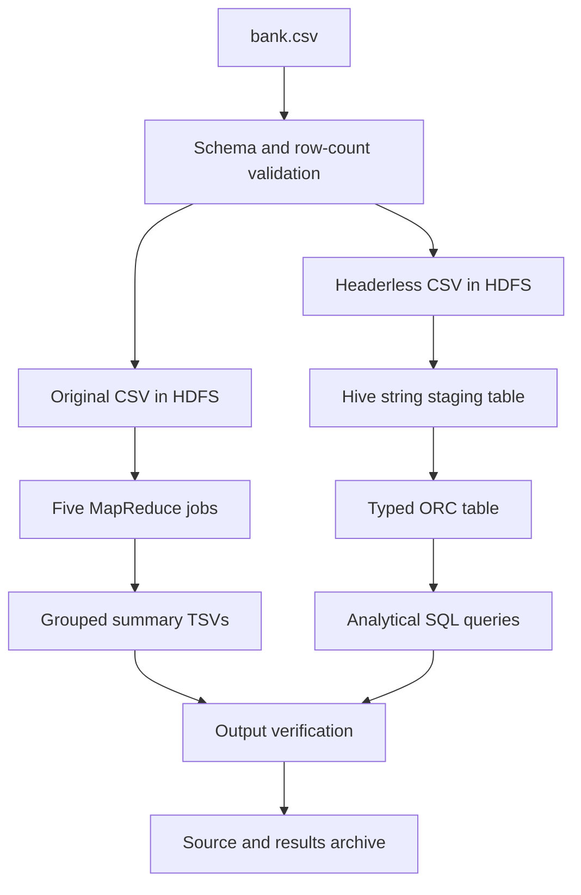

# Project Architecture

The project analyzes bank-marketing records using Python MapReduce and Hive SQL on a single-host pseudo-distributed Hadoop environment.

## Processing flow

## Components

| Component | Responsibility |
|---|---|
| HDFS | Input files, intermediate storage, and job outputs |
| YARN | Resource allocation for Hadoop and Hive jobs |
| Hadoop Streaming | Python mapper, combiner, and reducer execution |
| HiveServer2 and Beeline | SQL execution and query access |
| Embedded Derby catalog | Hive table metadata |
| GitHub Codespaces | Remote development host |

Hadoop Streaming runs batch MapReduce programs. The deployment uses one host with separate Hadoop service processes and a replication factor of one.

## Data handling

Input validation checks the semicolon-delimited schema and records row counts, label counts, and a SHA256 digest. MapReduce jobs preserve sums and nonmissing counts through combination, then calculate final means in reducers.

Hive reads a separate headerless CSV copy through a string staging table. Casts and normalization produce the typed ORC table. Input, staging, and typed row counts are compared for consistency. Hive uses the MapReduce execution engine.

Saved run directories contain summary TSVs, query logs, counts, and stage markers. Runtime installations, HDFS storage, and the catalog reside separately under `.codespaces-state`.

## Scope

The dataset supports descriptive customer and campaign analysis. Contact duration is measured in seconds. Record counts do not establish distinct customer counts. Age/balance correlation describes association; education/balance screening identifies review candidates. A year field is absent, so annual trends cannot be calculated.
